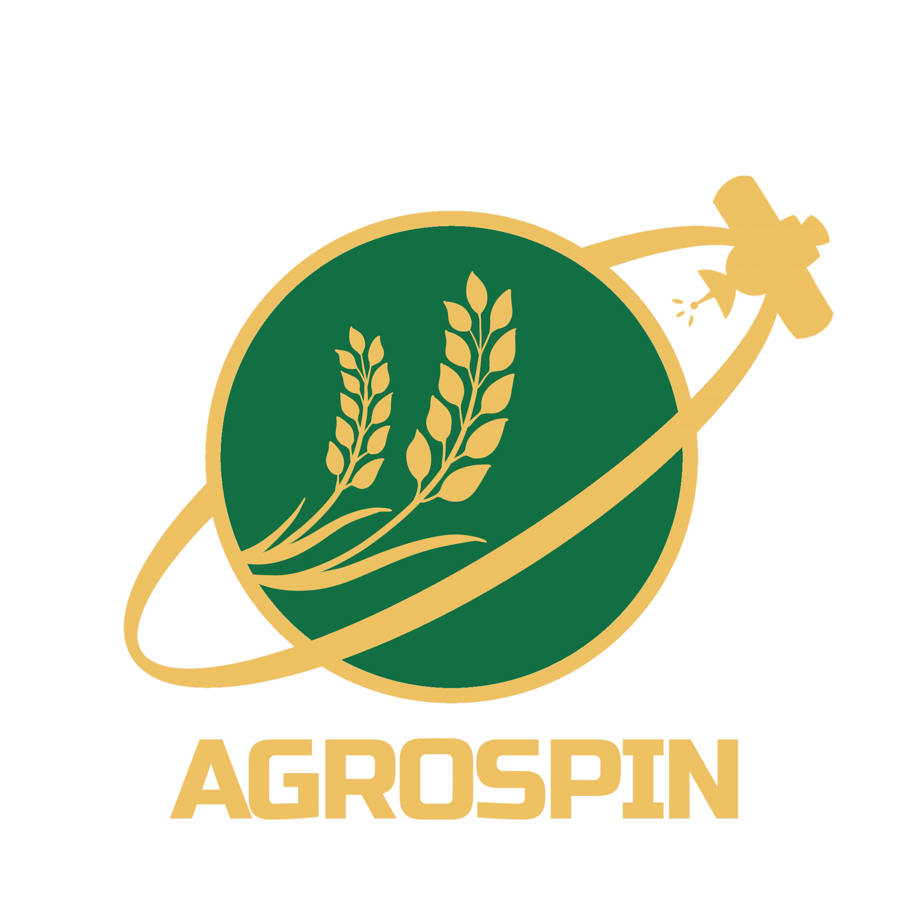

  

# AgroSpin (Field Shift) — NASA Space Apps Challenge 2026 MVP

Field Shift is an agricultural decision-support prototype for comparing crop-rotation alternatives under water stress and climate variability. It is **not just a satellite data viewer**.

**MVP area:** 65.875°W–64.125°W, 33.875°S–33.125°S (Villa Mercedes, San Luis, and southern Córdoba, Argentina). **Data cutoff:** 2026-11-01.

## Climate and soil evidence

The published datasets live in [`data/reference/mvp-homogeneous/`](data/reference/mvp-homogeneous/), with English-schema CSV/Parquet tables, a column dictionary, manifest, and checksums.

| Dataset | Decision-relevant information |
|---|---|
| `climate_monthly_grid_1991_2026`, `climate_annual_grid_1991_2026` | Historical regional rainfall, temperature, FAO-56 ETo, P−ETo, frost, heat-stress days, and growing degree days across 32 grid points |
| `climate_daily_grid_1991_2026`, `climate_zone_daily_1991_2026` | Daily climate series and a study-area aggregate |
| `enso_oni_monthly` | NOAA ONI and ENSO phase |
| `soil_1ha_grid`, `soil_500m_grid` | SRTM-derived elevation, slope, topographic susceptibility, and modeled mean soil moisture |
| `soil_gaez_crops_1981_2010` | FAO GAEZ v4 historical crop suitability and attainable-yield reference |
| `soil_sisinta_profiles_box` | INTA SISINTA profile horizons and available soil properties |
| `soil_moisture_monthly_grid_1991_2026` | Modeled mean monthly soil moisture, **not validated for daily correlation** |
| `ground_stations` | 19 ground weather station entries with locations and quality labels |

The `origin` field differentiates ground observations (`OBSERVED_*`), estimates (`ESTIMATED_*`), and references (`REFERENCE_*`). These must not be conflated. Verify the dataset files using `sha256sum -c SHA256SUMS` from the dataset directory.

## Scientific and product limitations

- NASA POWER regional climatology was compared with San Luis REM temperature data (reported correlation about **0.97**); this does **not** establish accuracy for individual parcels.
- SRTM-derived terrain includes flagged anomalous slopes. The topographic susceptibility index is **not a validated flood map**.
- The area includes 198 INTA SISINTA soil profiles (257 horizons), but only nine horizons have sufficiently complete texture and field-capacity information.
- GAEZ v4 crop suitability/yield data describe a historical 1981–2010 regional reference; local codebook coverage is incomplete.
- The soil-moisture balance model did **not** meet the daily correlation acceptance threshold (about 0.48–0.50 versus 0.60). Published monthly means carry the `UNVALIDATED_CORRELATION` warning.
- Regional data, including POWER and GAEZ, cannot be presented as direct parcel measurements merely because they are resampled.
- The repository contains an **interactive rotation-comparison simulator with scoring logic**, but the scores and rankings are **prototype outputs, not field-validated agronomic recommendations**.

### Interpretation of numeric uncertainty and scenario adjustments

The current rotation simulator uses fixed uncertainty labels (including **±28%**) and scoring adjustments to handle missing or sparse field-scale evidence in the study area. **These are engineering heuristics and scenario parameters**, not statistically estimated confidence intervals, calibrated prediction errors, or universally valid agronomic thresholds. The value ±28% does not have a demonstrated sampling distribution or independently validated coverage probability. It must be presented as an **illustrative uncertainty flag**, not as a probability or measured error bound.

Likewise, the simulator's weighted scores represent a prototype comparative rubric. Field data gaps explain why heuristics were introduced, but do not by themselves justify their numerical magnitudes. Independent soil samples and agronomic field validation are needed before such numbers can support operational decisions.

## Public project documentation

- [MVP data guide](data/reference/mvp-homogeneous/README.md), [manifest](data/reference/mvp-homogeneous/manifest.json), and [checksums](data/reference/mvp-homogeneous/SHA256SUMS)
- [NASA and local data source specifications](data/sources/README.md)
- [Data methodology](data/ARCHITECTURE.md) and [decision/evidence contracts](docs/contracts/README.md)
- [Crop catalog](docs/challenge/crop-catalog.yml), [project overview](docs/project-overview.md), and [NASA presentation](presentation/README.md)

This public repository provides the product code, reference datasets, scientific metadata, and documentation. It does not contain private operations data, credentials, or original upstream raw archives.
